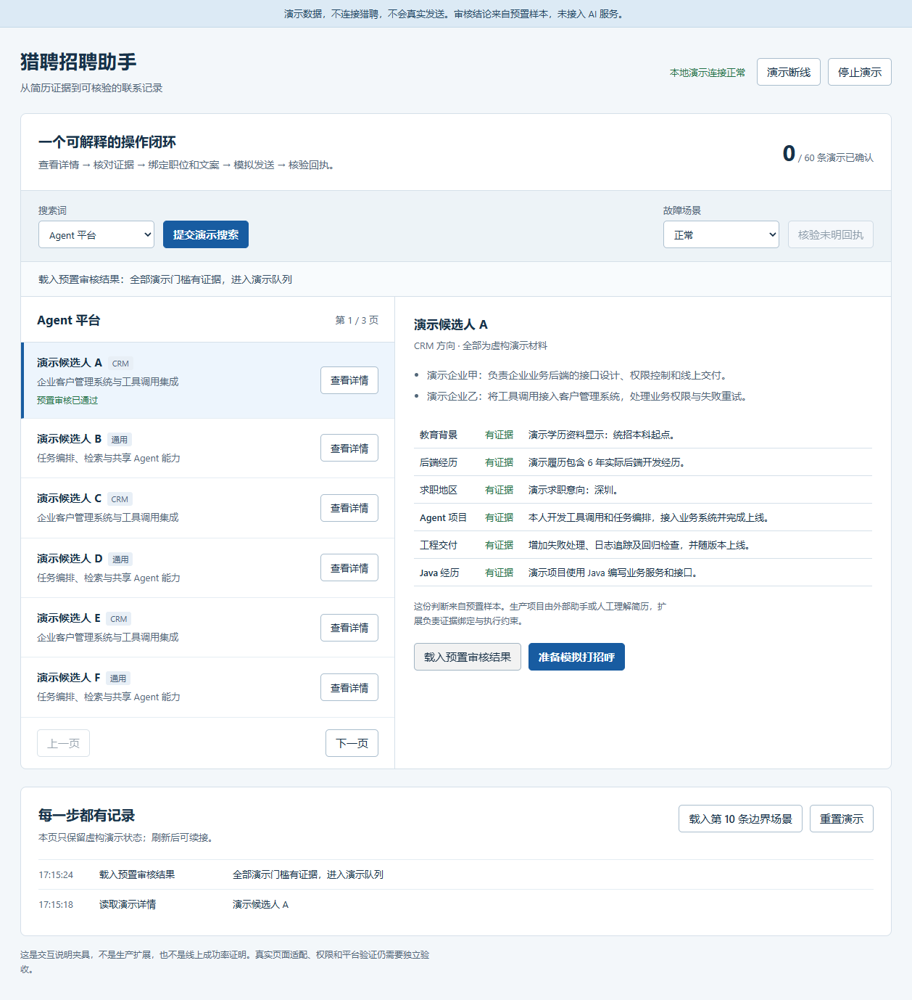
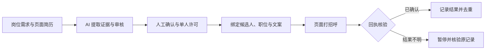

# Recruiting Copilot

**猎聘招聘辅助工具：从简历证据审核，到自动打招呼与回执核验。**

这是我在技术招聘实习中，围绕重复寻访和候选人建联流程开展的 AI 产品实践。我负责业务需求、操作流程、交互与验收设计，借助 AI 协作开发本地工具，并根据调试中发现的问题持续迭代。



截图来自虚构数据的离线演示，不涉及真实候选人。

## 为什么做这个工具

招聘工作需要逐份阅读简历，再搜索、打开详情、选择职位和打招呼。候选人是否合适需要证据判断，页面上的重复操作又容易受到弹窗、断线及超时影响。最难处理的一类问题是：按钮操作结束了，但不能确定消息是否真正发出。

我将流程拆成两个部分：外部 AI 助手负责阅读材料、提取原文证据与形成审核意见；本地执行器负责检查目标、执行已批准的页面操作并核验结果。模型判断与执行状态分别记录。



## 产品设计与关键取舍

| 业务问题 | 产品处理方式 |
|---|---|
| 简历结论缺少依据 | 审核结果关联简历快照与原文引用，证据不足保留待核实 |
| 联系对象或职位发生变化 | 准备和执行前核对候选人、职位与文案，单次许可绑定具体目标 |
| 超时后无法判断是否已发出 | 区分待执行、已确认与结果不明；未知结果先核验，避免盲目重试 |
| 断线或重复回传 | 持久化任务状态、结果与去重台账，支持中断后的核查与恢复 |
| 招聘方难以快速理解项目 | 提供无依赖的交互演示、界面截图、架构说明与测试记录 |

## 先看演示

下载仓库后直接打开 **[demo/index.html](demo/index.html)**，不需要账号、模型 API 或安装依赖。GitHub 源码页面不会直接运行 HTML，请下载后在浏览器打开。

建议演示路线：查看候选人 A → 载入预置审核结果 → 准备模拟打招呼 → 确认模拟发送 → 查看去重记录；再切换“模拟回执丢失”，观察工具如何进入待核验状态。

全部候选人和记录均为虚构数据，演示不连接猎聘、不调用模型、不发送真实消息。完整操作见 [演示说明](demo/README.md)。

## 本次发布验证

2026-11-12 对脱敏发布副本重新运行 **161 项自动化测试**：Node.js 113 项、Python 48 项，全部通过。范围为合成夹具和隔离本地服务；结果见 [测试摘要](docs/test-results.json)。另对公开打包范围执行隐私检查，未发现本机账号、岗位标识、手机号或凭据。

这些结果不代表真实猎聘平台发送成功率或长期稳定性。当前未补充真实发送测试，也没有可用于宣称效率提升或筛选准确率的对照数据。

## 源码与运行说明

一个从真实招聘工作中迭代出来的 AI 应用项目：外部 AI 助手负责阅读简历、提取证据与审核；本地 Python 服务和 Chrome 扩展负责可靠执行、限制发送范围、核验回执与恢复中断。

当前版本 **0.3.1**。这是一个有审核门槛的本地工具原型，不是无人值守的招聘 SaaS。扩展没有内置模型 API、LangChain、RAG 服务或自动回复功能。

本轮修复和验证边界见 [2026-11-02 验收记录](docs/overnight-acceptance-2026-11-02.md)。新增发送前 `preflight` 回读和 `serve --read-only` 测试模式；本轮未完成用户 Chrome 实机准备验收，未做真实发送测试。

## 先体验

直接打开 [离线演示](demo/index.html)。所有候选人、审核和发送均为模拟；不连接猎聘，不调用模型，不使用真实简历。

也可运行 `python demo/serve.py`，访问终端给出的本地地址。演示涵盖正常发送、结果不明、断线恢复、去重和每十人换词。演示模型与生产执行器分离，演示成功不算平台验收。

## 项目材料

- [项目架构与难点复盘](docs/项目架构与难点复盘.md)：从症状、定位、修复到验证，含状态图与取舍。
- [简历与面试讲解](docs/简历与面试讲解.md)：AI 应用开发方向的简历条目、90 秒讲法、追问与动手练习。
- [验收报告](docs/验收报告.md)：已测与待测范围，不能把测试通过率写成平台成功率。
- [运行与恢复手册](docs/运行与恢复手册.md)：安装、版本升级、断线、停机、未知发送处理。

## 结构

```text
extension/             MV3 面板、任务控制器、页面适配、证据存储
bridge.py              仅监听回环地址的鉴权任务桥
outreach_operator.py   审核证据复核、签发单人许可、确认台账
permits.py / ledger.py  许可与跨进程安全台账
test/                 合成回归、故障注入与本机 HTTP 测试
demo/                 完全脱敏的交互演示
tools/                回归、浏览器烟测与升级工具
docs/                 架构、复盘、面试材料、实测报告
```

## 本地验证

基础测试需要 Node.js 20+、Python 3.11+，无第三方生产运行依赖。

```powershell
python tools/verify.py
python build.py
```

测试使用隔离数据和回环 HTTP 服务，不访问真实候选人。回归摘要为 `docs/test-results.json`，详细日志仅在私有 `.runtime/test-results/`。

浏览器集成测试额外需要 Playwright 与可加载未打包扩展的 Chromium 浏览器：

```powershell
$env:PLAYWRIGHT_MODULE = 'playwright'
$env:SMOKE_CHROME = 'C:\Program Files (x86)\Microsoft\Edge\Application\msedge.exe'
node tools/browser-smoke.mjs
```

`PLAYWRIGHT_MODULE` 可为已安装模块的绝对路径。测试创建独立配置，仿真本机服务，不附着用户浏览器。本轮 MV3 烟测使用 Edge；不能替代当前用户 Chrome 上的猎聘验收。

## 安装与数据

开发使用 `extension` 目录。`python bridge.py status` 首次会生成仅本机使用的配置；`python bridge.py serve` 启动服务。Chrome 加载该目录后，打开助手面板和已登录的猎聘页。详情见运行手册。

生产账号、职位 ID、完整默认话术保存在本机 `extension/outreach-scope.json`，不进入 Git 或 ZIP。新克隆需创建此文件（格式见运行手册）；当前电脑的配置已保留。没有此文件时仅显示演示范围，Python 生产服务拒绝启动。

公开构建为 `release/Recruiting-Copilot-0.3.1-source.zip`。白名单打包并替换生产账号和职位为演示值；不含真实简历、台账、凭证、浏览器配置或历史审核文档。不要直接分享整个工作目录。

实时系统保留单岗位授权范围、每次单人许可、结果未知停止等约束。新角色需要重新配置和验证，不宣称已支持任意招聘平台。不会绕过验证码或读取平台隐藏接口。
