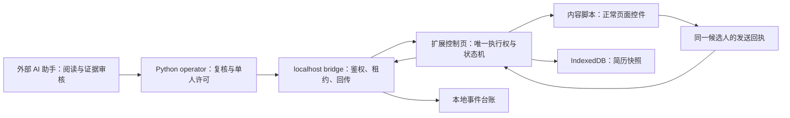
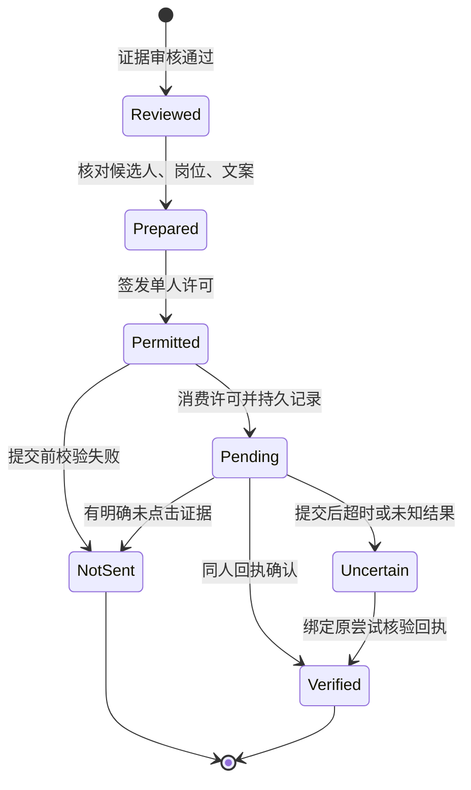

# 项目架构与难点复盘

## 项目解决什么问题

招聘工作需要从搜索列表进入简历，核对教育和项目证据，再选择正确岗位发送招呼。难点不仅是重复点击：搜索结果会变化、弹窗会延迟出现、连接会中断，简历中的“熟悉 AI”也不能直接当成实际项目经验。

因此，项目把“判断是否值得联系”和“把已批准的动作正确执行”分开。AI 提交带原文引用的结构化审核结果；执行器只处理满足授权和校验条件的候选人。

当前模型推理来自外部 Codex 对话。源码实现工具执行层和校验层，没有内置模型服务。这是当前架构边界，也是今后接入独立模型服务的接口位置。

## 系统结构

1. **模型层**：按岗位规则分析已读取的内容，产生方向、门槛状态、引用和解释。材料里的文本是数据，不能当系统指令。未知证据不能由执行器擅自补成通过。
2. **许可层**：校验简历 SHA-256、引用是否出现在原文、账号、岗位、当前准备状态；签发短期单人许可。
3. **任务桥**：仅绑定本机回环地址，校验 Bearer 与来源；任务先租出再执行，结果重复回传必须一致。
4. **浏览器层**：使用普通页面控件，核对候选人、职位、全文文案、控件可见性和页面版本。
5. **状态与证据层**：事件台账保存结果；IndexedDB 保存每人最新快照；控制状态与大文本分离。

代码中的唯一标识承担不同职责：candidateId 定位列表里的候选人；usercId 核对发送按钮绑定的人；jobId 确认岗位；digest 确认审核材料版本；permitId 限定一次动作；commandId 关联一次任务传输。不能用姓名、行号或公司名代替这些标识。

## 一次发送的状态

`Uncertain` 会阻止新增发送。重试回传同一结果可以，重新执行发送不可以。仅凭“请求返回成功”“弹窗关了”不记成功；仅凭“调用超时”也不能记未发送。

这不是端到端 exactly-once 保证。平台内部投递不受我们控制，用户也可能手动联系。我们实现的是一次许可防重放、同人绑定、回执确认和未知结果阻断。平台此前已联系的人只跳过，不能算成本轮新成果。

## 难点一：为什么刷新了还是连接失败

**症状**：面板只显示 Failed to fetch，用户反复刷新，无法判断是服务没开、旧页面、任务卡住还是存储写入失败。

**定位**：连接链包含本机服务、扩展控制页、任务租约、内容脚本四段。旧状态请求还把全部简历快照带回并再次持久保存。代码和数据体积支持“配额压力”的推断，但没有捕获到原故障现场的明确配额异常，不能说已经证明它就是唯一根因。

**修复**：状态不读全文；每份简历独立写入 IndexedDB。迁移等事务提交成功后再移除旧字段，失败保留。连接提示区分配置缺失和服务未响应；错误后有界退避重连；回传失败只重传相同结果。存储失败的兜底结果固定可重建，避免服务端已保存、响应丢失后客户端换一个结果导致冲突死锁。

**验证**：模拟配额异常、网络失败、丢响应；真实 Chromium IndexedDB 事务回滚、刷新保留、迁移与 MV3 面板断线重连。IndexedDB 仍受浏览器存储管理约束，不是无限容量；每人保留最新版，不是历史版本库。

Chrome 官方文档说明 storage.local 默认约 10 MB，因此数据分层比盲目重复写全量更合理。[Storage API](https://developer.chrome.com/docs/extensions/reference/api/storage)

## 难点二：弹窗为什么不能总靠用户点叉

**症状**：成功发送后的“相似候选人”或残留职位窗口挡住下一步；旧代码把所有可见对话框一律当阻断。

**修复**：先识别已知提示，再找到唯一正常关闭按钮，点击后等待消失。对工具自己已核验成功的遗留职位窗口，还要检查原 DOM、候选人、职位和文案都没变。未知窗口、用户改选的职位窗口、安全验证继续停止。

不移除遮罩，不修改站点限制。透明退出动画不再被误认为有效控件；真正遮挡仍拒绝点击。

**验证**：合成页面中跑通 prepare→send→回执→关本次遗留窗口→搜索；用户改选岗位后不得误关。当前平台所有弹窗形态尚未逐一现场验收。

## 难点三：超时之后为什么还可能点下去

JavaScript 的 Promise.race 超时只让调用方返回，不会自动取消页面上仍在等待的操作。旧任务可能继续滚动或点击，新任务又开始，形成竞态。

**修复**：控制器和内容脚本各有互斥锁。任务原始截止时间传到页面，等待循环、布局稳定后和最后点击前都检查；过期不能延迟点击。分页分支必须 await 页面操作再退出 finally，否则锁和截止时间会提前释放。

**验证**：延迟 health、滚动中到期、停止指令、超时后第二次操作、点击后无回执。提交后超时仍进未知状态；在点击边界不能证明未提交时宁可保守停止。

## 难点四：每十人换词和续接为什么容易算错

“本批发了多少”“今天发了多少”“这个词发了多少”是三个不同计数。提前换词或二十人批次结束时重置计数，会导致同词多发；跨午夜核验也会把昨天动作误算成今天。

**修复**：从 verified 事件恢复已核验数；每词 checkpoint 加跨批 carry 计算换词节点。提前换词重新计本词，换批保留未满十人的余数。台账按首次 pending 的上海日期归属，保留实际核验时间；跨日未决仍全局阻断。

**验证**：第九/十人、十九/二十人、五十九/六十人，提前换词、跨批余数与跨日回执。日预算只是本地已知上限，平台实际余额可能受其他操作影响。

## 难点五：为什么已有权限还要单人许可

已授权任务不等于允许任意页面上的任意按钮发送。等待期间用户可能切换候选人或岗位，页面也可能复用 DOM 行。

**修复**：发送前重新核对身份、岗位、文案、digest、批次和许可；许可在服务端消费，扩展也记录已使用许可。提交前失败输出结构化 notSent，已点击后未知走 uncertain。Python 台账使用跨进程锁和 fsync；相同许可相同结果幂等，冲突结果拒绝。

许可准备阶段使用 preparing→armed。若准备阶段中断，只能对证明未派发的 preparing 尝试执行恢复；已租出或已消费不按“没发送”处理。

## AI 在这里具体做了什么

AI 能处理五花八门的简历表述，将业务要求映射到真实工作和项目证据。确定性规则适合检查字段、引用、身份和预算，不能单独判断候选人是否真的有 Agent 落地能力。

模型结果包含 pass / fail / unknown 和原文引用，便于人工复核。但引用存在只证明可追溯，不证明语义判断绝对正确。因此没有准确率、召回率或无偏性保证，也没有给出未经标注数据集测量的分数。

若继续发展为独立 AI 应用，下一阶段应新增：模型适配器、JSON Schema 输出、脱敏标注集、审核一致性评测、Token/延迟埋点与失败分层监控。当前未完成这些功能，不能提前写进简历。

## 有意保留的取舍

- 使用打开的控制页持有唯一执行权，服务 worker 只负责打开面板。控制页关闭后不会承诺继续运行；Chrome worker 有生命周期限制。[官方生命周期说明](https://developer.chrome.com/docs/extensions/develop/concepts/service-workers/lifecycle)
- 不自动重发未知结果，牺牲一些连续性换取不误联系。
- 当前单账号、单岗位范围固定；跨平台、多人权限、自动回复都不在本版本。
- 白屏没有得到唯一根因；不宣传反检测或绕过验证。
- 旧无身份绑定的未知记录保留人工核验边界。重启后 DOM 绑定丢失，不能仅凭“继续沟通”自动归因给原动作。
- 事件与已用许可仍需长期归档策略；本轮未进行数月运行压力测试。
